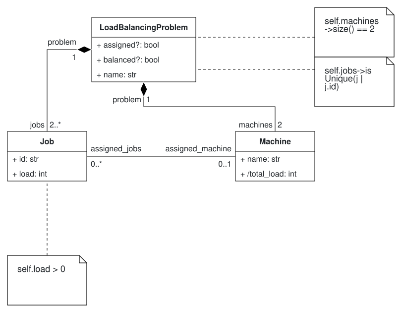
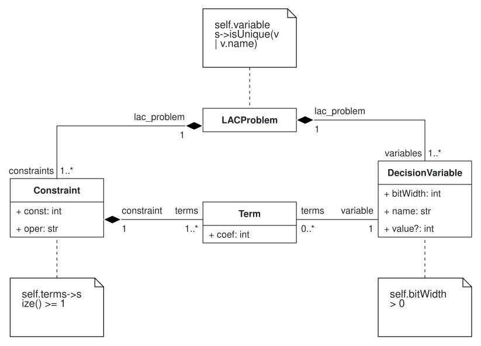

# Part I Report: Domain Analysis & Metamodel Design

**Course:** TACS 2627 — Quantum Model-Driven Engineering[cite: 1]  
**Problem Assigned:** C4— Load Balancing of Jobs on Two Machines with Equal Load 
**Technology Stack:** BESSER 

## 1. Domain Analysis & Literature Inspiration

The objective of Part I is to establish an abstraction boundary betwen scheduling domain concepts and lower-level quantum/algebraic execution models. The assigned problem is **Partition** (Class C4), a weakly  NP-complete decision problem in which a set of integer processing loads must be partitioned across two execution hosts such that both hosts carry equal total load.

Grover-based quantum search relies on complex reversible arithmetic. To hide low-level details—like qubit registers, bit-widths, and adder gate logic—from , our architecture splits the workflow into two distinct DSLs:

1. **Problem Domain (Load Balancing DSL):** Captures high-level concepts including job instances, processing loads, machine nodes, and execution assignments without exposing the mathematical topics.
2. **Intermediate Solution Domain (Linear Arithmetic Constraints - LAC DSL):** Encodes the problem into binary decision variables $y_i \in \{0, 1\}$, bit-widths, terms with coefficients, and relational constraint elements.

## 2. Concept Lists

Following the concept analysis methodology described in Brambilla et al. (2017, Fig. 7.4).
For the Problem DSL, each concept includes its intrinsic attributes, extrinsic associations, mapping to the Solution DSL (LAC).

#### Table 1: Problem DSL Concept Analysis (`LoadBalancingProblemDSL`)

| Concept | Intrinsic Properties (Attributes) | Extrinsic Properties (Connections) | Solution DSL Mapping ($T_1$ Target) |
| --- | --- | --- | --- |
| **`LoadBalancingProblem`** | `name : String` 

 `balanced : Boolean [0..1]` 

 `assigned : Boolean [0..1]` | Contains 2 `Machine` objects 

 Contains $\ge 2$ `Job` objects | Maps to root **`LACProblem`** instance holding global system constraints. |
| **`Job`** | `id : String` 

 `load : Integer` | Belongs to one `LoadBalancingProblem` 

 Assigned to $0..1$ `Machine` | Maps to a **`DecisionVariable`** $y_i$ ($y_i \in \{0,1\}$) and a linear **`Term`** with `coef = load`. |
| **`Machine`** | `name : String` 

 `/total_load : Integer` *(derived)* | Belongs to one `LoadBalancingProblem` 

 Executes $0..*$ `Job` objects | Derived target value $S/2$ maps to **`Constraint.const`** ($-S/2$). |

---

#### Table 2: Solution DSL Concept Analysis (`LACProblemDSL`)

| Concept | Intrinsic Properties (Attributes) | Extrinsic Properties (Connections) | Description / Role in Execution |
| --- | --- | --- | --- |
| **`LACProblem`** | *(none)* | Aggregates $\ge 1$ `Constraint` 

 Aggregates $\ge 1$ `DecisionVariable` | System root containing all arithmetic constraint equations. |
| **`DecisionVariable`** | `name : String` 

 `bitWidth : Integer` 

 `value : Integer [0..1]` | Belongs to one `LACProblem` 

 Referenced by $0..*$ `Term` objects | Unknown binary variable ($y_i$) mapped to qubit register index in $T_2$. |
| **`Constraint`** | `const : Integer` 

 `oper : String` | Belongs to one `LACProblem` 

 Aggregates $\ge 1$ `Term` objects | Represents atomic relation $\sum a_i y_i + \text{const} \text{ oper } 0$. |
| **`Term`** | `coef : Integer` | Belongs to one `Constraint` 

 References 1 `DecisionVariable` | Represents linear monomial term $a_i \cdot y_i$ inside a constraint atom. |

## 3. Problem DSL Metamodel & Justifications

### Structural Architecture
The Problem DSL consists of three main domain concepts:
* **`LoadBalancingProblem`**: The root container aggregating jobs and machines. Attributes include `name: StringType`, along with optional tracking flags `balanced: BooleanType` and `assigned: BooleanType`.
* **`Job`**: Represents an individual computational task with a unique identifier `id: StringType` and an integer processing duration `load: IntegerType`.
* **`Machine`**: Represents an execution host with a string `name: StringType` and a derived attribute `/total_load: IntegerType`.

### Multiplicities & Associations
* **`lb_has_jobs`**: Aggregation from `LoadBalancingProblem` to `Job` (`2..*`), enforcing that a load balancing instance must contain at least two jobs.
* **`lb_has_machines`**: Composite aggregation from `LoadBalancingProblem` to `Machine` (`2..2`), enforcing the 2-machine restriction of the Partition problem.
* **`job_assigned_machine`**: Unidirectional association from `Job` (`0..*`) to `Machine` (`0..1`), representing job-to-machine.

### OCL Constraints & Justifications
To prevent invalid problem definitions before model transformation, three OCL invariants are enforced:
* **`PositiveJobLoad`**: Enforces that job execution times are strictly positive (`self.load > 0`).
* **`UniqueJobIDs`**: Ensures job identifiers within a problem instance are distinct (`self.jobs->isUnique(j | j.id)`).
* **`ExactlyTwoMachines`**: Restricts the system host count strictly to two machines (`self.machines->size() == 2`).

## 4. Solution DSL Metamodel & Justifications

### Structural Architecture
The Solution DSL represents systems of linear arithmetic constraints suitable for Grover-based arithmetic
* **`LACProblem`**: The root container aggregating decision variables and constraint elements.
* **`DecisionVariable`**: Represents an unknown variable with attributes `name: StringType`, `bitWidth: IntegerType`, and an optional result attribute `value: IntegerType`.
* **`Constraint`**: Represents a linear relation atom $\sum a_i y_i + \text{const} \text{ oper } 0$, containing `const: IntegerType` and `oper: StringType`.
* **`Term`**: Represents a linear term $a_i y_i$, storing a coefficient `coef: IntegerType` and referencing a `DecisionVariable`.

### Multiplicities & Associations
* **`lac_has_constraints`**: Composite aggregation from `LACProblem` (1) to `Constraint` (`1..*`).
* **`lac_has_variables`**: Composite aggregation from `LACProblem` (1) to `DecisionVariable` (`1..*`).
* **`constraint_has_terms`**: Composite aggregation from `Constraint` (1) to `Term` (`1..*`).
* **`term_ref_var`**: Reference from `Term` (`0..*`) to `DecisionVariable` (`1..1`).

### Design Justifications & OCL Constraints
* **Explicit Bit-Width Attribute:** Setting `bitWidth = 1` for binary decision variables aligns directly with Class C specifications.

* **Explicit `Term` Class:** Decouples variables from constraint definitions, enabling reusable references and enabling static OCL validation
.
* **OCL Invariants:**
  * **`PositiveBitWidth`**: Ensures variable bit-width is non-zero (`self.bitWidth > 0`)
  * **`UniqueVariableNames`**: Ensures decision variable names are distinct (`self.variables->isUnique(v | v.name)`)
  * **`ConstraintMustHaveTerms`**: Ensures every constraint eleement contains at least one linear term (`self.terms->size() >= 1`)

## 6. Summary 

The Part I metamodels provide a  structural foundation implemented in BESSER with OCL constraints.

## 7. Appendix: Metamodel & Instance Diagrams

This appendix contains the rendered visual diagrams for both Domain-Specific Languages (Problem DSL and Solution DSL metamodels) 

### 6.1 Problem DSL Metamodel Diagram

---

### 6.2 Solution DSL Metamodel Diagram

### Concept Lists

Following the concept analysis methodology described in Brambilla et al. (2017, Fig. 7.4).
For the Problem DSL, each concept includes its intrinsic attributes, extrinsic associations, mapping to the Solution DSL (LAC).

#### Table 1: Problem DSL Concept Analysis (`LoadBalancingProblemDSL`)

| Concept | Intrinsic Properties (Attributes) | Extrinsic Properties (Connections) | Solution DSL Mapping ($T_1$ Target) |
| --- | --- | --- | --- |
| **`LoadBalancingProblem`** | `name : String` 

 `balanced : Boolean [0..1]` 

 `assigned : Boolean [0..1]` | Contains 2 `Machine` objects 

 Contains $\ge 2$ `Job` objects | Maps to root **`LACProblem`** instance holding global system constraints. |
| **`Job`** | `id : String` 

 `load : Integer` | Belongs to one `LoadBalancingProblem` 

 Assigned to $0..1$ `Machine` | Maps to a **`DecisionVariable`** $y_i$ ($y_i \in \{0,1\}$) and a linear **`Term`** with `coef = load`. |
| **`Machine`** | `name : String` 

 `/total_load : Integer` *(derived)* | Belongs to one `LoadBalancingProblem` 

 Executes $0..*$ `Job` objects | Derived target value $S/2$ maps to **`Constraint.const`** ($-S/2$). |

---

#### Table 2: Solution DSL Concept Analysis (`LACProblemDSL`)

| Concept | Intrinsic Properties (Attributes) | Extrinsic Properties (Connections) | Description / Role in Execution |
| --- | --- | --- | --- |
| **`LACProblem`** | *(none)* | Aggregates $\ge 1$ `Constraint` 

 Aggregates $\ge 1$ `DecisionVariable` | System root containing all arithmetic constraint equations. |
| **`DecisionVariable`** | `name : String` 

 `bitWidth : Integer` 

 `value : Integer [0..1]` | Belongs to one `LACProblem` 

 Referenced by $0..*$ `Term` objects | Unknown binary variable ($y_i$) mapped to qubit register index in $T_2$. |
| **`Constraint`** | `const : Integer` 

 `oper : String` | Belongs to one `LACProblem` 

 Aggregates $\ge 1$ `Term` objects | Represents atomic relation $\sum a_i y_i + \text{const} \text{ oper } 0$. |
| **`Term`** | `coef : Integer` | Belongs to one `Constraint` 

 References 1 `DecisionVariable` | Represents linear monomial term $a_i \cdot y_i$ inside a constraint atom. |